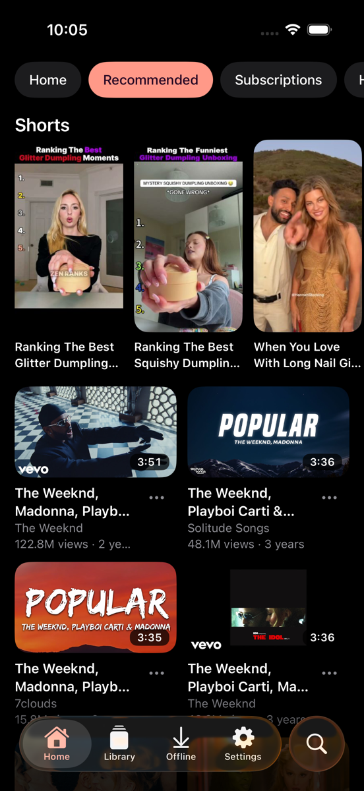
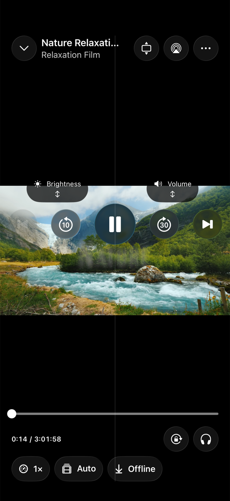
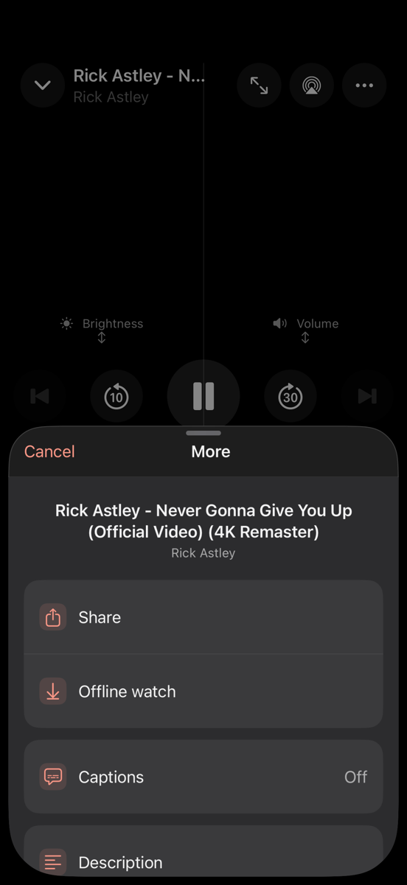
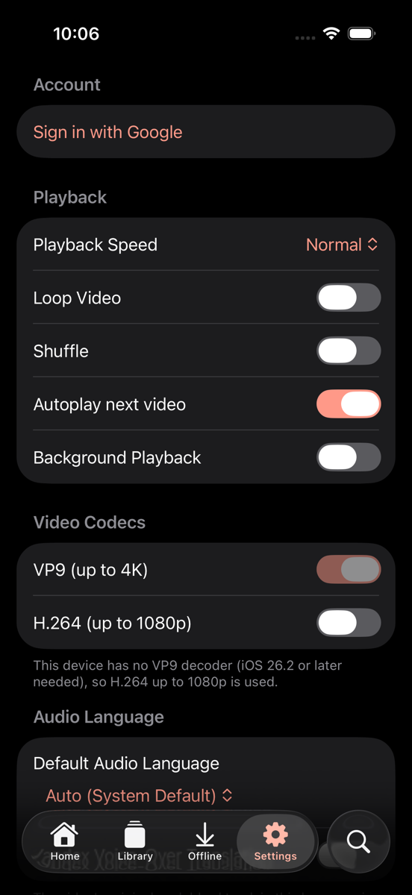

# VoxaFrame

Repository: [cioxideru/VoxaFrame](https://github.com/cioxideru/VoxaFrame).

A maintained fork of [SmartTubeIOS by milika](https://github.com/milika/SmartTubeIOS), licensed under [GPLv3](LICENSE). The fork keeps upstream attribution and uses its own name and icon.

A native Swift/SwiftUI YouTube client for **iPhone**, **iPad**, **macOS**, and **Apple TV**.  
Zero ads. SponsorBlock auto-skip. DeArrow community titles. Google sign-in. Up to 8K.

[](https://github.com/cioxideru/VoxaFrame) [](https://github.com/cioxideru/VoxaFrame) [](https://github.com/cioxideru/VoxaFrame) [](https://swift.org) [](https://ko-fi.com/milikadelic)

Build this fork with Xcode; the upstream App Store release is a separate product.

Inspired by the original [SmartTube Android app](https://github.com/yuliskov/SmartTube).

---

## Screenshots

<table>
  <tr>
    <td></td>
    <td></td>
    <td></td>
    <td></td>
    <td></td>
  </tr>
</table>

---

## Features

### Playback
- Adaptive HLS and DASH streaming — up to 8K via AVPlayer; manual quality picker (144p → 4K)
- Native AVPlayer on every platform, fed first by the VISIONOS client's HLS (H.264, up to 1080p)
- DASH adaptive quality switching via `AVMutableComposition` — no black frames, audio preserved on every switch
- Audio-only playback mode
- Landscape playback with one-tap orientation lock (iPhone)
- Picture-in-Picture (iOS)
- Mini-player with background audio
- Adjustable playback speed, seek interval, and sleep timer
- Previous / next video navigation
- Now Playing metadata on lock screen and Dynamic Island

### Audio & Captions
- Multi-track audio selection with a default audio language independent of the system language (original, English, dubbed, and more)
- Yandex voice-over translation (AVPlayer only) into the default audio language (Russian, English, Kazakh) for videos without a track in it:
  - the translation plays over the ducked or muted original audio ("Original Audio in Background")
  - optional lively voices for Russian, using your Yandex OAuth token stored in the Keychain ("How to Get a Token" in Settings)
  - per-video on/off toggle in the player's audio picker, even when a dubbed track exists
- Caption / subtitle track selection — language choice remembered across videos

### Content & Feeds
- Home, Subscriptions, Shorts, History, Search, Playlists, Library
- Local subscriptions — follow channels without a Google account
- RSS channel feeds with background refresh and deduplication
- iCloud sync for subscriptions, watch state, queue, and RSS feeds
- Video publish date shown in search results and feed cards

### Ad & Sponsor Blocking
- Zero ads, no tracking
- SponsorBlock — auto-skip with per-category controls and skip-button toast
- DeArrow community titles and thumbnails

### Integrations
- Google OAuth sign-in (YouTube TV device-code flow)
- Safari Web Extension — auto-redirects YouTube, Shorts, and Music links to VoxaFrame
- Share Extension — share YouTube links from any app directly into VoxaFrame
- Offline videos with a persistent download queue, progress page and completion notifications
- Save additional video qualities, original/dubbed audio and Yandex voice-over tracks; play downloaded media locally
- Downloads and speculative preloading yield while active playback prepares or buffers
- WatchTime reporting and Like / Dislike support
- VPN / IP-block detection with a clear, non-retrying error banner
- Comments, Stats for Nerds

### Platforms
- **iPhone & iPad** — iOS/iPadOS 18+
- **macOS** — native macOS 15+
- **Apple TV** — tvOS 18+, full Siri Remote / d-pad navigation

---

## Project Structure

```
SmartTubeIOS/          Swift Package — core library (models, InnerTube API, SponsorBlock, views)
SmartTubeApp/          Xcode project — app targets (iOS/iPadOS/macOS + Apple TV)
SmartTube.xcworkspace/ Xcode workspace (references both above)
```

---

## Requirements

| Platform | Minimum |
|---|---|
| iOS / iPadOS | 18.0 |
| macOS (native) | 15.0 |
| tvOS | 18.0 |
| Xcode | 27.0 (project toolchain) |
| Swift | 6.0 |

---

## Getting Started

```bash
git clone https://github.com/cioxideru/VoxaFrame.git
cd VoxaFrame
open SmartTube.xcworkspace
```

### Signing

The project requires an Apple Developer Team ID to build.

Copy `SmartTubeApp/Config/Secrets.xcconfig.example` to `SmartTubeApp/Config/Secrets.xcconfig` and fill in your Team ID:

```
DEVELOPMENT_TEAM = YOUR_TEAM_ID
SMARTTUBE_TV_TEAM = YOUR_TEAM_ID
```

`Secrets.xcconfig` is gitignored and will never be committed; `setup.sh` installs it for you if you have access to the private config repo.

---

## Contributing

Pull requests are welcome. See [.github/PULL_REQUEST_TEMPLATE.md](.github/PULL_REQUEST_TEMPLATE.md) for the checklist.  
Please ensure `Secrets.xcconfig` is **never** included in a PR.

---

## Changelog

See [CHANGELOG.md](CHANGELOG.md) for a full version history.

---

## Support

Support the original SmartTubeIOS author through [milika's Ko-fi](https://ko-fi.com/milikadelic).

---

## License

[GPL-3.0](LICENSE)
