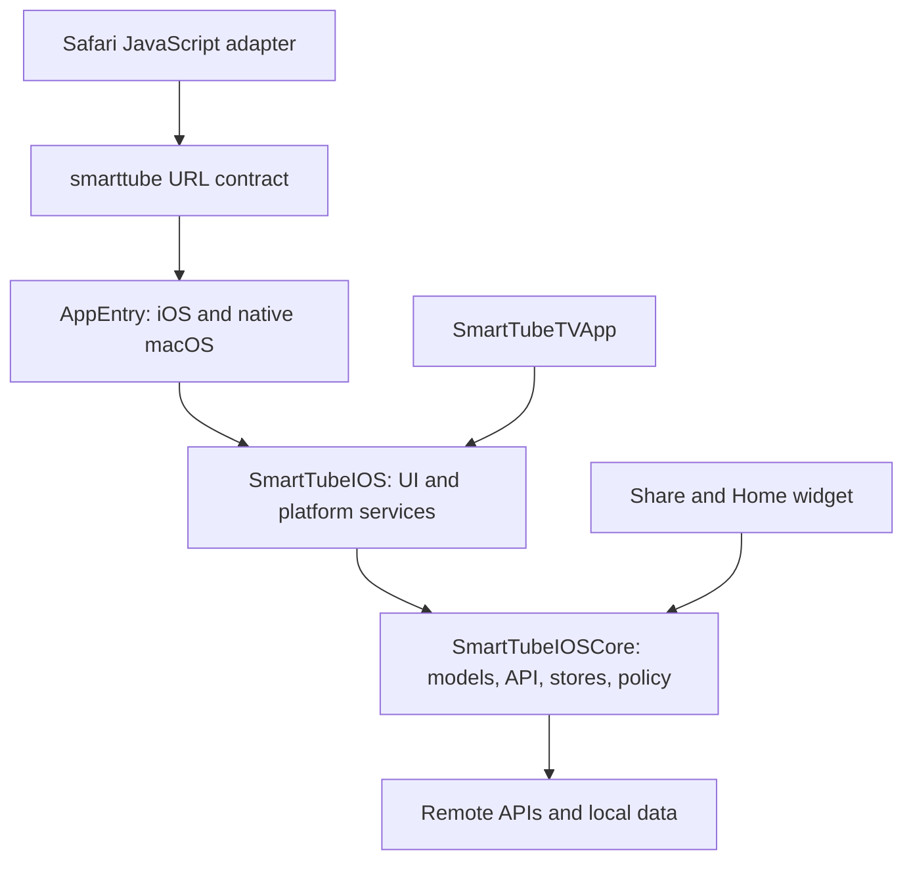

# Architecture and framework audit — October 2026

- Scope: PLAN-0029, package AUDIT; documentation only.
- Source snapshot: `4e343553154d664b27c5ba5e87f3abbe3c52df4b`, inspected 2026-10-18.
- Status: recommendations and source findings; no implementation or runtime acceptance.
- Decisions: [ADR index](adr/README.md); new proposals are ADR-0014–0018. ADR-0013 is reserved for the separate minimum-OS package.

## Scope and conclusion

What this repo does: VoxaFrame is a native YouTube client with browsing, account and local libraries, regular video and Shorts playback, translation, and offline media. This audit assumes one person using the app, potentially with several Mac windows, an app extension, background downloads, and a second device syncing data. It does not assume a server workload.

Keep SwiftUI, Observation, Swift concurrency and AVPlayer. The largest problems are ownership and integration: the app's pending-inbox reader uses a stale App Group literal, incoming iCloud changes are not applied, queue playback retains positional identity, and navigation and system playback commands have multiple consumers. The inbox regression silently loses Share actions while the extension reports success; the direct video URL path and widget are unaffected. A framework replacement would not fix those contracts.

The agreed future floor is **iOS/iPadOS 18, native macOS 15, tvOS 18**. The inspected manifest still says 17/14/17 ([Package.swift:7–10](../SmartTubeIOS/Package.swift#L7)); some tvOS target settings say 17.6. This audit does not implement the change or write ADR-0013. The later Swift-module and target rename is also separate. Bundle IDs **will change to `com.ibaranov.voxaframe.*`**: the user decided on 2026-10-18 to accept a new installed-app identity. The [rename contracts](#rename-contracts) below distinguish the resulting fresh local data from independently retained shared identifiers.

Behavior was checked against the [functional brief](design/voxaframe-redesign/docs/VoxaFrame-Functionality.ru.md), [handoff](design/voxaframe-redesign/START-HERE.md), and markup for [navigation](design/voxaframe-redesign/mockups/C-Navigation.dc.html), [Mac Home](design/voxaframe-redesign/mockups/M-Home.dc.html), [iPhone player](design/voxaframe-redesign/mockups/P-Player.dc.html), [TV player](design/voxaframe-redesign/mockups/T-Player.dc.html), [Shorts](design/voxaframe-redesign/mockups/X-Shorts.dc.html) and [optional downloads](design/voxaframe-redesign/mockups/S-Optional.dc.html). Mockup markup was inspected, not rendered. Its proposed interactions do not establish implemented behavior.

Inventory covers all Swift source in the package and app targets, configuration, and test locations. Deep tracing covered entry/composition, external actions, player ownership, queue, settings/sync, resource lookup and offline persistence seams. The full InnerTube parser family, every fallback branch, all translations and every test body were not reviewed line by line. No build, test, simulator, signed extension, device, live network playback, performance or iCloud experiment was run. Apple API references below were checked on 2026-10-18; this is not an exhaustive SDK deprecation scan.

## Measured baseline

Counts are textual, at the source snapshot above. Swift files include comments and inactive conditional branches; counts are not executed paths, violations, runtime test cases or coverage percentages.

| Scope / measurement | Count | Interpretation |
|---|---:|---|
| `SmartTubeIOSCore` | 87 Swift files / 17,725 lines | Models, API, stores, decision logic and several platform adapters |
| `SmartTubeIOS` | 164 Swift files / 32,997 lines | UI, player, services and an unused app definition |
| App and extension source, excluding `UITests` | 8 Swift files / 2,084 lines | Two app entry points, delegate, Siri, Share, Safari and widget files |
| `PlaybackViewModel*.swift` in `ViewModels/` | 29 files / 6,981 lines | File splitting has not created separate runtime owners |
| `.shared` in package source / `Views/` | 263 / 60 occurrences | Includes appropriate system singletons; inspect ownership before changing |
| `CurrentQueueStore.shared` in package / app source | 28 / 3 occurrences | Queue access remains spread across player, screens and entry code |
| `.openChannel` publisher subscribers in `Views/` | 6 files | Home, Browse, Channel, Search, Playlist, Library |
| `NavigationStack` constructors in `Views/` | 12 | Includes independent sheets; not evidence of nesting by itself |
| `.padding(` / `VFSpace.` in `Views/` | 251 / 189 occurrences | Different denominators: spacing tokens also appear in stacks |
| Numeric-first padding calls in `Views/` | 69 in 23 files | Literal value, optionally after an edge argument; excludes calculated/multiline expressions |
| Package `nonisolated(unsafe)` / `@unchecked Sendable` | 21 / 17 textual occurrences | Includes explanatory comments; not a race count |
| Package `DispatchQueue` / NotificationCenter publishers | 12 / 14 occurrences | Includes required platform bridges and historical code |
| Package `ObservableObject`, `@Published`, `import Combine` | 0 / 0 / 0 | Observation migration is real; publishers still bridge notifications |
| Package catalog | 521 keys; 443 with `ru`, 138 with explicit `en` | English source keys often supply English without an explicit locale entry |
| Package UI lines containing `Text("` | 329; 223 have `bundle: .module` on that line | Remaining 106 are review candidates, including interpolation and nontranslatable text |
| Unit-test source | 138 files importing Swift Testing; 1,248 `@Test` annotations | Includes conditional/parameterized tests; none run here |
| UI-test source | 77 Swift files | Helpers and conditionally disabled files included |
| Unit-test sleeps | 6 `Task.sleep`, 2 `Thread.sleep` | Separate from production timers and cancellation waits |
| UI-test sleeps | 323 `Thread.sleep`, 4 bare `sleep` | Fixed waits remain a substantial acceptance cost |

Reproduce the inventory with `rg --files SmartTubeIOS/Sources SmartTubeIOS/Tests SmartTubeApp`; count only `*.swift`, excluding `SmartTubeApp/UITests` from app production source. Line counts use `len(path.read_text().splitlines())`. The lexical recipes are `\.shared\b`, `CurrentQueueStore\.shared\b`, `\bNavigationStack\s*[({]`, `\.padding\s*\(`, `\bVFSpace\.`, and `\.padding\(\s*(?:\.[A-Za-z]+\s*,\s*)?-?\d`. Text counts use lines matching `\bText\("` and a same-line bundle check. Catalog counts come from `strings` and the presence of each locale in `localizations`; they do not assess translation quality. Test recipes count `@Test\b`, `Task\.sleep\s*\(`, `Thread\.sleep\s*\(` and `(?<![.\w])sleep\s*\(` separately.

## Architecture and module boundaries

The package has two library products, one combined test target and no external SwiftPM dependencies ([Package.swift:12–49](../SmartTubeIOS/Package.swift#L12)). The Xcode project has two app targets, three extensions and two UI-test targets ([project target declarations:508–647](../SmartTubeApp/SmartTubeApp.xcodeproj/project.pbxproj#L508)). Its `SmartTube` target supports `iphoneos iphonesimulator macosx` and disables Catalyst in both [Debug:954–959](../SmartTubeApp/SmartTubeApp.xcodeproj/project.pbxproj#L954) and [Release:1433–1438](../SmartTubeApp/SmartTubeApp.xcodeproj/project.pbxproj#L1433).

Different app shells and cross-language URL adapters are legitimate boundaries. The Core import policy already permits Observation, logging and CryptoKit as well as Foundation; “Foundation-only” is therefore a portability/ownership goal with a documented allowlist, not literally one import.

### A01 — Core still contains platform adapters (P2; M; order 5)

**Evidence.** [Import guard:7–19](../scripts/check-core-imports.py#L7) exempts five files: Network in `InnerTubeAPI` and `VideoPreloadCache`, JavaScriptCore in `BotGuardClient`, ActivityKit in `DownloadActivityAttributes`, and ImageIO/UniformTypeIdentifiers in `HomeWidgetSnapshot`. The ActivityKit path is disabled. Beyond imports, [TokenManager:173–212](../SmartTubeIOS/Sources/SmartTubeIOSCore/TokenManager.swift#L173) calls Security Keychain functions and [iCloudSyncManager:43](../SmartTubeIOS/Sources/SmartTubeIOSCore/iCloudSyncManager.swift#L43) constructs Apple's cloud store. [HomeWidgetSnapshot:69–74, 163–192](../SmartTubeIOS/Sources/SmartTubeIOSCore/HomeWidgetSnapshot.swift#L69) combines value data with App Group discovery and image conversion.

**Impact.** A Core-only unit test can instantiate network monitoring, Keychain or cloud facilities. A passing import check does not prove an OS-independent model boundary; Share/widget clients also inherit unrelated adapter dependencies.

**Recommendation.** Keep value types, API contracts and deterministic policy in Core. Move network-path monitoring, JS execution, Keychain/cloud integration and image/container work to platform services, injecting only the narrow capabilities their consumers need. Keep Foundation-backed URLSession and local JSON where they already have test seams; do not move every service merely because it does I/O. Delete the disabled ActivityKit model if Gallery is retired. [ADR-0016](adr/0016-core-platform-adapters.md) specifies the staged boundary and extension constraints. Acceptance: zero unexplained platform-import exceptions, plus adapter tests for network transitions, credentials and widget images.

### A02 — Composition and lifetime differ by entry point and window (P1; M; order 3)

**Evidence.** [AppEntry:51–80](../SmartTubeApp/Sources/AppEntry.swift#L51) and `SmartTubeApp/Smart Tube/Smart_TubeApp.swift:24–41` repeat settings/API/auth/feed construction. The former configures offline services; the latter does not. [AppEntry:18–25, 128–177](../SmartTubeApp/Sources/AppEntry.swift#L18) keeps browsing and Home state at App scope, outside `WindowGroup`; Mac windows receive the same objects. All three shells independently create `SearchViewModel()` ([MainTabView:41](../SmartTubeIOS/Sources/SmartTubeIOS/Views/Shell/MainTabView.swift#L41), [MainSidebarView:20](../SmartTubeIOS/Sources/SmartTubeIOS/Views/Shell/MainSidebarView.swift#L20), [MainTVTabView:11](../SmartTubeIOS/Sources/SmartTubeIOS/Views/Shell/MainTVTabView.swift#L11)). Its [default initializer:71](../SmartTubeIOS/Sources/SmartTubeIOSCore/SearchViewModel.swift#L71) creates `InnerTubeAPI()` with a [nil auth token:277](../SmartTubeIOS/Sources/SmartTubeIOSCore/InnerTubeAPI.swift#L277), bypassing the configured authenticated API; the [environment API default:6–7](../SmartTubeIOS/Sources/SmartTubeIOS/InnerTubeAPIKey.swift#L6) constructs another concrete API. A third, 93-line [package SmartTubeApp:5–92](../SmartTubeIOS/Sources/SmartTubeIOS/SmartTubeApp.swift#L5) has no `@main` and no constructor reference in tracked source.

**Impact.** Startup work can be added to the wrong root, as happened with iCloud (A08). Multiple Mac windows share `deepLinkedVideo` and browse selections while owning separate navigation stacks. Default constructors can silently create differently configured API instances. Per-target differences need an explicit capability decision, rather than copying startup code.

**Recommendation.** Apply accepted [ADR-0004](adr/0004-plain-init-injection.md): one composition root per app target, using a shared plain-initializer service factory, process services and scene-owned navigation state. Share account and durable stores deliberately; keep each window's destinations and presentation local. Migrate needed startup hooks, then delete the unused app definition. Do not add a DI framework or treat every `.shared` as wrong. [ADR-0015](adr/0015-composition-and-playback-lifetimes.md) records the lifetime contract. Acceptance: two independent Mac windows and explicit startup fixtures for each target.

## Navigation, external actions and playback state

There **is** a typed external route enum: [SmartTubeRoute:43–109](../SmartTubeIOS/Sources/SmartTubeIOSCore/SmartTubeURLScheme.swift#L43), with [round-trip tests](../SmartTubeIOS/Tests/SmartTubeIOSTests/SmartTubeURLSchemeTests.swift#L56). It is not a unified navigation state model. Reuse it instead of introducing another URL parser.

| Platform | Current presentation and ownership | Preserve |
|---|---|---|
| iOS/iPadOS | [PlayerRouter:24–29](../SmartTubeIOS/Sources/SmartTubeIOS/PlayerRouter.swift#L24) → `PlayerStateStore`; [MainTabView:113–139](../SmartTubeIOS/Sources/SmartTubeIOS/Views/Shell/MainTabView.swift#L113) owns mini overlay and UIKit cover | One persistent player layer, PiP ownership, mini/fullscreen handoff |
| Native macOS | [MainSidebarView:39–46](../SmartTubeIOS/Sources/SmartTubeIOS/Views/Shell/MainSidebarView.swift#L39) pushes player; [PlayerView:123–126](../SmartTubeIOS/Sources/SmartTubeIOS/Views/Player/PlayerView.swift#L123) creates its playback model | Content-stack player and window inspector; no new mini-player/PiP |
| tvOS | [MainTVTabView:16–23](../SmartTubeIOS/Sources/SmartTubeIOS/Views/Shell/MainTVTabView.swift#L16) supplies tab stacks; [HomeView:116–119](../SmartTubeIOS/Sources/SmartTubeIOS/Views/Home/HomeView.swift#L116) pushes, while [ChannelView:53–56](../SmartTubeIOS/Sources/SmartTubeIOS/Views/Channel/ChannelView.swift#L53) covers | Focus/remote controls and platform Back behavior; presentation forms need consistent routing |

### A03 — The app's pending-inbox reader uses a stale App Group (P0; S; order 1)

**Evidence.** [ShareViewController:21–25](../SmartTubeApp/ShareExtension/ShareViewController.swift#L21) uses `HomeWidgetStore.appGroup`, defined as `group.com.ibaranov.smarttube` at [HomeWidgetSnapshot:55](../SmartTubeIOS/Sources/SmartTubeIOSCore/HomeWidgetSnapshot.swift#L55). Every App Group entitlement agrees: [iOS app:11](../SmartTubeApp/SmartTubeApp/SmartTubeApp.entitlements#L11), [native Mac app:11](../SmartTubeApp/SmartTubeApp/SmartTubeApp-macOS.entitlements#L11), [Share:7](../SmartTubeApp/ShareExtension/SmartTubeShareExtension.entitlements#L7), and [widget:7](../SmartTubeApp/DownloadWidget/SmartTubeDownloadWidget.entitlements#L7). Only the app's pending-inbox reader retains `group.com.void.smarttube` at [AppEntry:45–49](../SmartTubeApp/Sources/AppEntry.swift#L45). Regression commit `7f1e270` (2026-10-14, `chore(signing): fork bundle IDs, app group and signing team`) changed the entitlements, shared constant and Share producer but omitted this reader. All four pending-action keys are separately declared in both entry files.

**Impact.** With this configuration, Share actions “Add to Watch Later”, “Add to Queue” and “Add to RSS” are always silently lost to the app: its consumers read the stale suite ([AppEntry:483–548](../SmartTubeApp/Sources/AppEntry.swift#L483)), while the extension reports success after writing the granted suite ([Watch Later/Queue:267–299](../SmartTubeApp/ShareExtension/ShareViewController.swift#L267), [RSS:457–469](../SmartTubeApp/ShareExtension/ShareViewController.swift#L457)). “Open in VoxaFrame” through the [video URL path:402–407](../SmartTubeApp/ShareExtension/ShareViewController.swift#L402) and the widget are unaffected by this regression. The test-launch shortcut explicitly bypasses shared defaults ([AppEntry:629–644](../SmartTubeApp/Sources/AppEntry.swift#L629)), so that shortcut cannot validate the container contract. This effect follows from the source and commit history; signed-device reproduction remains outstanding.

**Recommendation.** Put the existing granted group identifier and four key names in one Foundation value contract, and use it in app, Share and widget adapters. Do not rename entitlements as a shortcut. Finish this single App Group constant before the VoxaFrame rename, so that later work changes one authoritative identifier and keeps the entitlement declarations in agreement. Test the producer/consumer round trip with an injected suite and compare configured entitlements; then run a real Share action and cold launch. As routing evolves, acknowledge pending actions after acceptance and prevent duplicate URL/inbox delivery ([ADR-0014](adr/0014-scene-navigation-and-external-actions.md)).

### A04 — Navigation is broadcast and partly platform-specific (P1; M; order 3)

**Evidence.** Six views subscribe to `.openChannel` without a scene or active-screen filter; examples are [HomeView:141–144](../SmartTubeIOS/Sources/SmartTubeIOS/Views/Home/HomeView.swift#L141) and [ChannelView:66–69](../SmartTubeIOS/Sources/SmartTubeIOS/Views/Channel/ChannelView.swift#L66). [AppEntry:386–397](../SmartTubeApp/Sources/AppEntry.swift#L386) converts typed routes back to notifications with dictionary payloads. Only [MainTabView:100–108](../SmartTubeIOS/Sources/SmartTubeIOS/Views/Shell/MainTabView.swift#L100) consumes the search query route; Mac's [MainSidebarView:50–52](../SmartTubeIOS/Sources/SmartTubeIOS/Views/Shell/MainSidebarView.swift#L50) listens to a different, queryless search notification. The section listener in [HomeView:145–156](../SmartTubeIOS/Sources/SmartTubeIOS/Views/Home/HomeView.swift#L145) is iOS-only.

**Impact.** A Mac `smarttube://search?q=...` reaches the parser and posts an event with no Mac consumer. A channel action can mutate every retained subscriber, including a previous screen in the stack; exact retained-view behavior needs UI reproduction. iOS has a special direct-player branch because the underlying view does not consume changes while covered ([AppEntry:422–435](../SmartTubeApp/Sources/AppEntry.swift#L422)). These are delivery and ownership issues, not a reason to give all platforms identical presentations.

**Recommendation.** One `@MainActor @Observable` navigation owner per scene should consume typed intents, own selected section/path/modal state and hand playback requests to the platform presenter. Keep Core's external parser and stable IDs. Remove route notifications after callers migrate; retain OS lifecycle notifications. Do not place `NavigationStack` inside destination screens that already have a host stack; sheets may legitimately own independent stacks. [ADR-0014](adr/0014-scene-navigation-and-external-actions.md). Acceptance: cold/warm links, link while player is open, channel from a pushed screen, and two-window routing without duplicate pushes.

### A05 — Queue identity is a position copied into a video (P1; M; order 2)

**Evidence.** [CurrentQueueStore:73–115](../SmartTubeIOS/Sources/SmartTubeIOSCore/CurrentQueueStore.swift#L73) tags copies with `playlistIndex`; `clear`/`replaceAll` do not invalidate a player's copy. [PlaybackViewModel+Navigation:57–69, 122–144](../SmartTubeIOS/Sources/SmartTubeIOS/ViewModels/PlaybackViewModel+Navigation.swift#L57) advances using that index and clears the entire current store when no next item exists. [QueueView:42, 55–58, 113–115](../SmartTubeIOS/Sources/SmartTubeIOS/Views/Common/QueueView.swift#L42) reads snapshots on appearance/refresh and clears independently. The visible-queue handoff calls `replaceAll(with: visible)` ([PlaylistViewModel:37–43](../SmartTubeIOS/Sources/SmartTubeIOSCore/PlaylistViewModel.swift#L37)); [CurrentQueueStore:102–104](../SmartTubeIOS/Sources/SmartTubeIOSCore/CurrentQueueStore.swift#L102) persists that replacement. There are 31 direct `CurrentQueueStore.shared` references across package/app production source.

**Impact.** Source-traced case: play B at index 1, minimize, clear the queue, then append D. B still carries index 1; Next looks up index 2, finds nothing, and clears D. Removing/reordering before a playing item has the same positional hazard. Duplicate video IDs are explicitly allowed by `replaceAll`, so video ID alone is not a sufficient replacement identity. Separately, starting playback from the filtered queue permanently drops hidden Shorts and other filtered items from the stored queue; turning the filter off cannot restore them. No runtime reproduction was run.

**Recommendation.** First prevent exhaustion of an old queue revision from clearing a newer queue. Then give queue entries stable identity and mutations a revision; let the store own advance/clear policy and publish snapshots, with the playback cursor tied to that identity/revision. Inject the same queue into cards, player and queue loader; do not make display arrays another durable source. Treat the destructive visible-queue handoff as an explicit product decision: should filtering only skip hidden items during playback, or remove them from durable storage? Record the chosen behavior before changing this path. Test clear/append while playing, duplicate IDs, reorder, stale end events and hide/play/unhide behavior. See [ADR-0017](adr/0017-durable-store-and-sync-ownership.md).

### A06 — Player instances compete for process-wide remote commands (P1; M, then L; order 2/6)

**Evidence.** Regular iOS playback uses a persistent model. In contrast, [ShortsPlayerView.init:56–60](../SmartTubeIOS/Sources/SmartTubeIOS/Views/Player/ShortsPlayerView.swift#L56) and the tvOS/macOS branch of [PlayerView.init:123–126](../SmartTubeIOS/Sources/SmartTubeIOS/Views/Player/PlayerView.swift#L123) eagerly construct `PlaybackViewModel` as a `State(initialValue:)` argument. Every UIKit-capable model init installs remote commands ([PlaybackViewModel:513–521](../SmartTubeIOS/Sources/SmartTubeIOS/ViewModels/PlaybackViewModel.swift#L513)); setup calls `removeTarget(nil)` eight times ([+NowPlaying:95–109](../SmartTubeIOS/Sources/SmartTubeIOS/ViewModels/PlaybackViewModel+NowPlaying.swift#L95)). Its [deinit:545–554](../SmartTubeIOS/Sources/SmartTubeIOS/ViewModels/PlaybackViewModel.swift#L545) removes all those targets again. Now Playing publication and remote-command handling are compiled only under `canImport(UIKit)` ([+NowPlaying:5–25](../SmartTubeIOS/Sources/SmartTubeIOS/ViewModels/PlaybackViewModel+NowPlaying.swift#L5)); there is no native Mac equivalent. The family still totals 6,981 lines in 29 files and accepts concrete API/services at [init:478–511](../SmartTubeIOS/Sources/SmartTubeIOS/ViewModels/PlaybackViewModel.swift#L478).

**Impact.** If an older player is released after a newer player registers commands, the old cleanup can remove the new player's handlers. Parent re-evaluation that reconstructs these view values also eagerly creates throwaway models even when SwiftUI retains the installed `@State` model. On iOS/tvOS, their init registers and their deinit removes all remote-command targets, so ordinary view updates can make the hazard frequent; actual frequency and timing need runtime confirmation. Native macOS has the eager-construction cost but none of this UIKit-only system integration: the app has no media-key or Control Center Now Playing integration. File decomposition alone leaves stream resolution, queue advance, history, system metadata and rendering state under one model.

**Recommendation.** First give one platform service ownership of remote-command registrations, with an active playback owner token and targeted cleanup. Move global registration out of model init/deinit and construct playback models at their intended lifetime boundary, so view re-evaluation cannot replace system handlers. Add a native Mac system-media adapter rather than leaving that service behind a UIKit guard. Reuse the ownership approach in [PlaybackAudioSession:6–9, 59–94](../SmartTubeIOS/Sources/SmartTubeIOS/Services/PlaybackAudioSession.swift#L6); keep the single iOS layer and the bounded Shorts preloader. Then extract session bookkeeping and implement the already-proposed [ADR-0005 pipeline](adr/0005-stream-source-pipeline.md) in behavior-preserving slices. `InitialPlayerInfoSource` is a useful existing seam, not a completed pipeline ([source:17–37](../SmartTubeIOS/Sources/SmartTubeIOS/Services/InitialPlayerInfoSource.swift#L17)). [ADR-0015](adr/0015-composition-and-playback-lifetimes.md) addresses lifetime only and does not supersede ADR-0005. Acceptance: parent re-evaluation and old-player disposal cannot affect active commands; native Mac media keys/Control Center work; stream-order/cancellation parity before replacing each fallback branch.

## Concurrency and dependency injection

### A07 — Strict concurrency is enforced in the package, not consistently at the app boundary (P1; M; order 4)

**Evidence.** [Package.swift:28, 42, 49](../SmartTubeIOS/Package.swift#L28) selects Swift 6 for all three targets. The Xcode file has fourteen `SWIFT_VERSION = 5.9` entries and two project-level `5.0` entries, with no explicit `SWIFT_STRICT_CONCURRENCY` setting; examples: [project:1072, 1144, 1228](../SmartTubeApp/SmartTubeApp.xcodeproj/project.pbxproj#L1072). Package source also retains 21 textual unsafe-isolation and 17 unchecked-Sendable occurrences. The clearest unprotected cross-actor property is [iCloudSyncManager.syncEnabled:36–39](../SmartTubeIOS/Sources/SmartTubeIOSCore/iCloudSyncManager.swift#L36), written from [SettingsStore:58](../SmartTubeIOS/Sources/SmartTubeIOS/Services/SettingsStore.swift#L58).

**Impact.** Compiling the package in Swift 6 does not establish that extension/delegate/startup code meets the same contract. The unsafe sync toggle bypasses compiler protection. Conversely, a callback or `@unchecked Sendable` is not automatically a defect: [OfflineDownloadTransport:25–71](../SmartTubeIOS/Sources/SmartTubeIOS/Services/OfflineDownloadTransport.swift#L25) documents a serial delegate queue and locks, and the audio-session intent lock has a defined role.

**Recommendation.** Align every app/extension/test target with Swift 6 through Xcode and inspect effective Debug/Release settings. Replace the cloud toggle with an actor-isolated configuration operation. Review each remaining escape by its synchronization invariant and cancellation/cleanup tests; preserve required delegate bridges and queue arguments at the OS boundary. Do not mechanically replace AVFoundation callbacks, thread-confined JavaScriptCore execution or production timers. Prefer injected clocks and protocol seams over extra global state. Acceptance belongs to all platform builds and focused race/lifecycle tests, not source annotations alone.

## Persistence and synchronization

### A08 — iCloud sync has storage hooks but no complete running workflow (P1; M; order 2)

**Evidence.** The only production `iCloudSyncManager.shared.start()` call is in the unused [package app:69–73](../SmartTubeIOS/Sources/SmartTubeIOS/SmartTubeApp.swift#L69). [SettingsStore:30–37, 54–58](../SmartTubeIOS/Sources/SmartTubeIOS/Services/SettingsStore.swift#L30) loads the saved toggle but forwards it only on later saves. The manager exposes [changes:47–52 and pull:98–100](../SmartTubeIOS/Sources/SmartTubeIOSCore/iCloudSyncManager.swift#L47); production source has no consumer of either. Four stores schedule pushes after writes, but [queue clear:94–96](../SmartTubeIOS/Sources/SmartTubeIOSCore/CurrentQueueStore.swift#L94) removes the defaults entry directly and skips `persist()`, including its cloud-push hook. The identity-change observer token is discarded at [iCloudSyncManager:67–73](../SmartTubeIOS/Sources/SmartTubeIOSCore/iCloudSyncManager.swift#L67); [cleanup:122–129](../SmartTubeIOS/Sources/SmartTubeIOSCore/iCloudSyncManager.swift#L122) removes `self`, not that token. The [external-change observer:110–119](../SmartTubeIOS/Sources/SmartTubeIOSCore/iCloudSyncManager.swift#L110) also discards its token.

**Impact.** A saved enabled toggle does not initialize this workflow on cold launch; incoming changes do not update local stores. Simply adding `start()` would leave observer lifetime, delete propagation, task ordering and conflict behavior unresolved. The [tests:49–79](../SmartTubeIOS/Tests/SmartTubeIOSTests/iCloudSyncManagerTests.swift#L49) mutate the global unsafe flag and accept no-crash results; they do not prove two-device synchronization.

**Interim recommendation (S; order 2).** Until ADR-0017's workflow lands, hide or disable the [“Sync to iCloud” toggle:286](../SmartTubeIOS/Sources/SmartTubeIOS/Views/Settings/SettingsView.swift#L286), or clearly label it as unavailable/incomplete. The current control promises synchronization that the running app cannot perform. This small UI change does not depend on completing the store/sync redesign.

**Recommendation.** One process-lifetime sync adapter should own opt-in startup, observer tokens, ordered export, incoming updates and shutdown/account changes. Local stores remain the only durable mutation owners; they publish revisions and apply validated incoming changes without immediately echoing them back. Preserve local data, existing keys and opt-in defaults. Define conflict/deletion policy before enabling incoming writes; test it with an in-memory cloud adapter. Whole snapshots must respect Apple's 1 MB total key-value quota, with visible errors rather than silent loss ([Apple KVS documentation](https://developer.apple.com/documentation/foundation/nsubiquitouskeyvaluestore?v=1.1.1)). [ADR-0017](adr/0017-durable-store-and-sync-ownership.md).

**What to keep.** [UserDefaultsBackedStore:47–65](../SmartTubeIOS/Sources/SmartTubeIOSCore/UserDefaultsBackedStore.swift#L47) already centralizes JSON persistence; [AppSettings decoding](../SmartTubeIOS/Sources/SmartTubeIOSCore/AppSettings.swift#L439) has migration defaults. The offline store commits an atomic manifest before publishing state ([OfflineLibrary:113–147](../SmartTubeIOS/Sources/SmartTubeIOSCore/OfflineLibrary.swift#L113)), while [OfflineCoordinator:69–89](../SmartTubeIOS/Sources/SmartTubeIOS/Services/OfflineCoordinator.swift#L69) injects transport, resolver, time, validation and notifications. These are useful patterns. Small bounded settings/queue data do not by themselves justify a SwiftData or Core Data migration. Credentials remain in Keychain; migration must surface Keychain write failures rather than silently deleting/replacing values ([TokenManager:188–203](../SmartTubeIOS/Sources/SmartTubeIOSCore/TokenManager.swift#L188)).

## Localization and design system

### A09 — Catalog coverage and resource lookup are separate problems (P1; M; order 2)

**Evidence.** The catalog is a SwiftPM resource ([Package.swift:37–41](../SmartTubeIOS/Package.swift#L37)). [SettingsView:88–90, 127, 163](../SmartTubeIOS/Sources/SmartTubeIOS/Views/Settings/SettingsView.swift#L88) uses literal `Text` without the module bundle. Of 329 UI lines containing `Text("`, 106 have no same-line module bundle, subject to the counting caveat above. Apple documents that a nil bundle uses the main bundle ([Text initializer](https://developer.apple.com/documentation/swiftui/text/init%28_%3Atablename%3Abundle%3Acomment%3A%29)). Separately, [ShellItem:22–25](../SmartTubeIOS/Sources/SmartTubeIOS/Views/Shell/ShellItem.swift#L22) explicitly renders section raw values verbatim; [MainTVTabView:20](../SmartTubeIOS/Sources/SmartTubeIOS/Views/Shell/MainTVTabView.swift#L20) also passes raw strings. There are 78 catalog keys without `ru`; this includes intentional nontranslatable keys and is not 78 confirmed UI defects.

**Impact.** Adding a Russian catalog translation does not fix a view looking in the app bundle. Raw navigation IDs are also being used as English display labels. Non-view copy has the same gap: [OfflineNotifications:25](../SmartTubeIOS/Sources/SmartTubeIOS/Services/OfflineCoordinator.swift#L25) is a hard-coded English title, and [ShareViewController:41–81](../SmartTubeApp/ShareExtension/ShareViewController.swift#L41) uses untranslated button strings in a separate target.

**Recommendation.** Package UI uses explicit module-bundle lookup, including labels, alerts and accessibility text; keep runtime user/video text verbatim. Give sections localized display titles while retaining every raw value and accessibility value. Inventory extension/intent resources separately because `.module` is not an app-wide bundle. Add English/Russian entries for new copy with the catalog's existing formatting and plural structure. Check changed keys, actual bundle lookup and one Russian shell/settings/offline flow per platform. Update the misleading sample in [localization guide](how-to/localization.md), which currently omits the module bundle. [ADR-0018](adr/0018-localization-resource-ownership.md).

### A10 — Token adoption is substantial but incomplete (P2; M; order 5)

**Evidence.** [VFMetrics:8–51](../SmartTubeIOS/Sources/SmartTubeIOS/Views/DesignSystem/VFMetrics.swift#L8) owns spacing, radii, input targets, margins and motion. `Views/` has 189 `VFSpace.` references but 69 numeric-first padding calls; examples are [PlayerView+Overlays:125–157](../SmartTubeIOS/Sources/SmartTubeIOS/Views/Player/PlayerView+Overlays.swift#L125) and [SignInView:158](../SmartTubeIOS/Sources/SmartTubeIOS/Views/Common/SignInView.swift#L158). [VFGlass:50–66](../SmartTubeIOS/Sources/SmartTubeIOS/Views/DesignSystem/VFGlass.swift#L50) owns availability/transparency fallback for custom surfaces; [TabBarLiquidGlassConfigurator:27–40](../SmartTubeIOS/Sources/SmartTubeIOS/Views/TabBarLiquidGlassConfigurator.swift#L27) separately styles the system tab bar. Extension UI still has literal colors and symbols ([ShareViewController:39–86](../SmartTubeApp/ShareExtension/ShareViewController.swift#L39)).

**Impact.** A spacing or surface change does not reach all matching visual roles. The counts cannot tell which literals are deliberate media geometry, safe-area measurements, zero spacing or design debt. The tab-bar adapter and custom glass modifier serve different native surfaces, so deleting one as a duplicate would lose behavior.

**Recommendation.** Continue [ADR-0012](adr/0012-redesign-availability-and-tokens.md)'s ownership policy by component, starting with common cards, menus, settings and player panels. Map repeated design-role values to tokens; keep measured geometry and meaningful one-off dimensions explicit. Feed a common glass preference to both legitimate adapters and verify Reduce Transparency/contrast/motion across them. Preserve `AppSymbol`, `PlaybackTuning` and the Core/UI-test accessibility mirror. [DesignTokenTests:36–98](../SmartTubeIOS/Tests/SmartTubeIOSTests/DesignTokenTests.swift#L36) cover reference color pairs, not all rendered surfaces. Acceptance requires visual/accessibility checks and a ratchet for new unapproved literals, not a target of zero numeric padding.

## Dead paths and platform/framework choices

### A11 — Retire inactive Gallery code and obsolete entry/platform paths deliberately (P2; S–M; order 5)

**Evidence.** No tracked package, Xcode or script configuration defines `ENABLE_DOWNLOADS`. Four wholly guarded production files total 987 lines: [VideoDownloadService:1–592](../SmartTubeIOS/Sources/SmartTubeIOS/Services/VideoDownloadService.swift#L1), [DownloadsView:1–182](../SmartTubeIOS/Sources/SmartTubeIOS/Views/Common/DownloadsView.swift#L1), [DownloadStore:1–162](../SmartTubeIOS/Sources/SmartTubeIOSCore/DownloadStore.swift#L1), [DownloadActivityAttributes:1–51](../SmartTubeIOS/Sources/SmartTubeIOSCore/DownloadActivityAttributes.swift#L1). The unused package app contributes another 93 lines. Four `targetEnvironment(macCatalyst)` occurrences remain in three view files, although target settings disable Catalyst; examples: [PlayerSwipeGestureOverlay:33,147](../SmartTubeIOS/Sources/SmartTubeIOS/Views/Player/PlayerSwipeGestureOverlay.swift#L33), [HomeView:90](../SmartTubeIOS/Sources/SmartTubeIOS/Views/Home/HomeView.swift#L90). Negated Catalyst guards contain active code on supported platforms and must be unwrapped, not deleted wholesale.

**Impact.** A second download architecture appears maintainable without ever being compiled. [LibraryUITests:608–615](../SmartTubeApp/UITests/LibraryUITests.swift#L608) still requires its disabled Downloads segment. Contributors can mistakenly change the unused app definition or copy obsolete platform assumptions from [README:79](../README.md#L79), the [architecture guide](architecture.md), and [AGENTS.md:3, 6](../AGENTS.md#L3), which still says “macOS Catalyst” / “iOS+Catalyst app” at this snapshot.

**Recommendation.** If no maintained special Gallery build is required, remove its guarded implementation and call sites; otherwise give that build an explicit owner and independent acceptance configuration. This is a proposed scope decision, not permission to enable Gallery. Preserve active `OfflineCoordinator`/`OfflineLibraryStore` and the Home widget: [DownloadLiveActivity:134–143](../SmartTubeApp/DownloadWidget/DownloadLiveActivity.swift#L134) is also the active widget bundle entry. Move that entry before deleting its file. Remove the unused package app after relocating required hooks, simplify Catalyst-only branches, and reconcile native-Mac documentation. Verify whether the parallel minimum-OS package has already corrected AGENTS.md before assigning that documentation fix. At least 1,080 production lines are retirement candidates; net deletion and any dependency change remain unmeasured. Do not rename modules or alter the Xcode project by hand.

### A12 — Frameworks are mostly current; modernize integration, not the engine (P2; S–M; order 4/5)

**Evidence and recommendation.** The following table distinguishes supported APIs, project debt and genuinely old usage. The OS-floor change removes only fallbacks below the new minimum; it does not make all 26+ APIs available.

| Framework / API | Current use and status | Action for 18/15/18 |
|---|---|---|
| SwiftUI + Observation | `@Observable` view models and `@State`/environment injection already match [Apple's Observation model](https://developer.apple.com/documentation/swiftui/migrating-from-the-observable-object-protocol-to-the-observable-macro?language=objc). Zero package `ObservableObject`/`@Published` occurrences. | Keep; fix ownership and lifetimes. No TCA/Combine rewrite. |
| NavigationStack / NavigationSplitView | Current [data-driven navigation APIs](https://developer.apple.com/documentation/swiftui/navigationstack); see the shell evidence above. No `NavigationView` occurrence found in production Swift. | Use a typed scene path; keep platform shells and independent modal stacks. |
| `Tab`, `.sidebarAdaptable` | Adopted behind iOS 18 at [MainTabView:179–228](../SmartTubeIOS/Sources/SmartTubeIOS/Views/Shell/MainTabView.swift#L179); [Apple's tab/sidebar guidance](https://developer.apple.com/videos/play/wwdc2024/10147/?time=465) describes this model. | Remove the iOS 17 branch only after ADR-0013 lands. Preserve tab identity and Queue selection through width changes. |
| Liquid Glass / bottom accessory | [VFGlass:58](../SmartTubeIOS/Sources/SmartTubeIOS/Views/DesignSystem/VFGlass.swift#L58) gates glass at 26; the mini-player is still an overlay, not `tabViewBottomAccessory`. [Apple glass API](https://developer.apple.com/documentation/swiftui/view/glasseffect%28_%3Ain%3A%29). | Keep newer-OS guards and opaque/accessibility fallback. A bottom-accessory migration requires persistent-layer/PiP parity, not a cosmetic replacement. |
| AVFoundation / AVKit / MediaPlayer | [AVPlayer](https://developer.apple.com/documentation/avfoundation/avplayer) is the current engine. [AssetTrackLoader:23–28](../SmartTubeIOS/Sources/SmartTubeIOS/ViewModels/AssetTrackLoader.swift#L23) uses async track loading. [PlayerView+AVLayer:180–205](../SmartTubeIOS/Sources/SmartTubeIOS/Views/Player/PlayerView+AVLayer.swift#L180) has a native AppKit layer adapter. | Keep layers, PiP and appropriate KVO/delegate bridges. Apple deprecates synchronous asset-property loading for Swift; retain async `load`/`loadTracks` ([guidance](https://developer.apple.com/documentation/avfoundation/loading-media-data-asynchronously?changes=_6_2&language=objc)). No `loadValuesAsynchronously`, synchronous `tracks(withMediaType:)` or `exportAsynchronously` call was found in the production textual scan. Fix A06 ownership. |
| Background URLSession / AVAssetDownloadURLSession | [OfflineDownloadTransport:61–70](../SmartTubeIOS/Sources/SmartTubeIOS/Services/OfflineDownloadTransport.swift#L61) uses background delegates; HLS creation is iOS-only. Delegates and app-delegate completion handling are part of [Apple's background-download contract](https://developer.apple.com/documentation/foundation/downloading-files-in-the-background?changes=latest_minor%2Clatest_minor). | Keep OS callbacks at the adapter boundary. Do not replace durable background sessions with an ordinary task or add HLS download support on Mac/TV by changing a conditional. |
| AppIntents, CoreSpotlight, WidgetKit | [SiriShortcuts:19–38](../SmartTubeApp/Sources/SiriShortcuts.swift#L19), [SpotlightIndexer](../SmartTubeIOS/Sources/SmartTubeIOS/Intents/SpotlightIndexer.swift), and [HomeFeedWidget](../SmartTubeApp/DownloadWidget/HomeFeedWidget.swift) use current integration families. [App Intents](https://developer.apple.com/documentation/appintents) remains the action interface. | Keep; converge action delivery on the scene router and test actual bundles/entitlements. Existing iOS scope is not proof of parity on Mac/TV. |
| WebKit / JavaScriptCore | WebKit services resolve streams/challenges; they are not the removed IFrame playback engine ([ADR-0010](adr/0010-remove-iframe-player.md)). JavaScriptCore remains in Core's exception list. | Keep necessary extraction adapters, isolate their thread/lifetime rules, move them out of Core. Do not reintroduce embedded playback or a new browser engine. |
| Foundation persistence / Security / iCloud KVS | Small JSON stores, atomic offline manifest and Keychain are distinct responsibilities. KVS is current but quota-limited; A08 identifies missing workflow. | Fix error handling, injection and sync semantics. No automatic SwiftData/Core Data/CloudKit replacement. |
| UIKit / AppKit interop, NotificationCenter publishers, GCD | Native layer, focus, slider and lifecycle bridges are not inherently obsolete. Route broadcasts and hierarchy traversal are project coupling; `DispatchQueue` occurrences include OS delegate requirements. | Keep real OS adapters. Replace app-owned route broadcasting; reduce hierarchy probing only after a public SwiftUI replacement proves parity. |

**Impact.** Treating all older-looking APIs as obsolete would remove working background, focus and playback behavior. Conversely, calling all APIs “modern” would hide unreachable platform UI: [ShortsPlayerView:68–79](../SmartTubeIOS/Sources/SmartTubeIOS/Views/Player/ShortsPlayerView.swift#L68) still renders black instead of a Mac video layer, as the functional brief records. Wire and validate the existing AppKit layer in the Mac follow-up rather than changing playback engines. This audit does not claim that the Mac Shorts UI is complete.

## Tests and verification boundaries

### A13 — Existing seams are useful, but the acceptance matrix misses integration contracts (P1; M; order 1 onward)

**Evidence.** Unit tests use Swift Testing in all 138 files. `InnerTubeAPIProtocol`, [QueuedPlaylistLoader](../SmartTubeIOS/Sources/SmartTubeIOSCore/PlaylistViewModel.swift#L13), [InitialPlayerInfoSource](../SmartTubeIOS/Sources/SmartTubeIOS/Services/InitialPlayerInfoSource.swift#L17), and offline injected drivers provide useful seams. However, [ci.sh:12](../scripts/ci.sh#L12) runs native package tests; [PlayerRouterQueueTests:1](../SmartTubeIOS/Tests/SmartTubeIOSTests/PlayerRouterQueueTests.swift#L1) is iOS-only. [verify.sh:16–25](../scripts/verify.sh#L16) builds iOS/tvOS, omits the native Mac app, and skips UI execution without a Smoke plan. Fixed waits remain: 327 UI sleep calls and 8 package-test sleep calls in the inventory. [iCloudSyncManagerTests:49–79](../SmartTubeIOS/Tests/SmartTubeIOSTests/iCloudSyncManagerTests.swift#L49) neither isolates the shared flag nor asserts incoming synchronization.

**Impact.** A passing native package run can miss iOS player tests, extension sharing, resource-bundle lookup and native app composition. Launch-argument fixtures can bypass the failing production boundary. Sleeps may delay execution without proving that the intended state was reached. The historical pass counts in other documents are not evidence for this snapshot.

**Recommendation.** Keep fast fake-based unit tests, then add a small platform/extension acceptance matrix owned by the coordinator. Replace sleeps in touched suites with controllable completion/clock seams or condition-based waits; serialize suites that still share globals under one parent, or inject isolated stores. Extend existing UI-test files when adding acceptance scenarios. Do not create brittle tests that merely count tokens or duplicate implementation logic.

| Contract to prove | Smallest meaningful next check |
|---|---|
| Share → app inbox | Injected-suite round trip and entitlement comparison, then signed Share action followed by cold launch |
| Routing | Each external route selects one destination in one window; repeat while player/modal is open |
| Queue | Playing B → clear → append D → Next preserves D; duplicate IDs and stale revision events; hide/play/unhide follows the explicit retention decision |
| Active playback | Parent re-evaluation and releasing old regular/Shorts models cannot unregister active commands; native Mac media keys and Control Center integration |
| Sync | Interim toggle is hidden/disabled or clearly labeled; then saved opt-in at launch, ordered writes, incoming apply, clear/delete, quota failure, identity change, no feedback loop |
| Localization | Russian shell/settings/offline text resolves from the right bundle; raw IDs remain unchanged |
| OS/platform support | Native Mac app plus iOS/tvOS targets, new minimum versions and a newer glass-capable OS; iOS-conditional package suites separately |
| Device behavior | PiP, remote commands, background transfer restoration, signed extensions and two-device sync; simulator/source checks cannot prove these |

## Ownership decisions

These rows distinguish today's runtime owner from the first fix and the intended long-term owner. A platform-specific presentation or storage adapter is legitimate; duplicate ownership means two places can independently decide the same product action.

| Concern | Runtime owner today | First fix owner | Canonical long-term owner | Competing owners that are wrong / cleanup direction |
|---|---|---|---|---|
| External inbox contract | AppEntry, Share controller, widget constant | AppEntry's incorrect group selection | Core value contract; app/extension storage adapters | Delete repeated key/group declarations; retain target-specific delivery adapters |
| Route delivery and visible path | AppEntry, browse model, per-screen notification listeners | Shell route consumers | Scene navigation owner in `SmartTubeIOS`; Core external route values | Delete dictionary route broadcasts and browse-as-mailbox state after migration |
| Queue order and advancement | Core queue plus player index and view snapshots | Queue mutation/advance seam | Core queue identity/revision policy; scene playback cursor | Remove player-owned whole-queue clearing and durable display copies |
| Remote-command ownership | Each playback model | Platform remote-command adapter | One process service with active session token | Remove blanket teardown from individual models; retain native system bridge |
| Startup and dependency lifetimes | Two real roots and unused package app | Real app roots | Per-target composition; shared service factory; scene UI state | Delete unused root and hidden default dependencies on production paths |
| Sync mutations | Local stores and disconnected cloud manager | Real composition root and sync adapter | Local store is sole durable writer; platform adapter transports changes | Remove direct cloud pushes scattered in stores after ordered export exists |
| Localized text | Package catalog, implicit main-bundle lookup, raw IDs | Package views and extension resources | Resource owner supplies display text; Core supplies stable data/IDs | Remove implicit bundle assumptions and localized labels used as identity |

## Prioritised roadmap

Sizes estimate implementation plus focused checks: **S** = one bounded change, roughly 1–2 days; **M** = several connected files/contracts, roughly 3–7 days; **L** = staged work across subsystems, over a week. They are planning ranges, not measured delivery commitments. P0 is a concrete cross-process mismatch; P1 is a functional/lifetime or acceptance gap; P2 is planned structural cleanup. This package implements none of the roadmap.

| Order | Work / finding | Size | Dependency and exit evidence |
|---:|---|---|---|
| 1 | Repair the App Group contract (A03); establish targeted acceptance (A13) | S + M incrementally | No architecture rewrite required. Existing identifiers retained; producer/consumer and signed-extension checks |
| 2 | Guard queue revisions and decide hidden-item retention (A05), isolate remote-command lifetime (A06), label/hide/disable the sync toggle then restore the workflow (A08), fix resource lookup (A09) | S for interim sync UI; M per structural fix | Independent bounded fixes before broader moves; use the scenarios above, including view re-evaluation and native Mac system-media integration |
| 3 | Accept/refine typed scene routing and lifetime proposals (A02/A04; ADR-0014/0015) | M each | Baseline route tests first; preserve iOS layer/PiP, Mac stack and TV focus; remove migrated broadcasts/duplicate roots |
| 4 | Align Swift 6 target settings and the new OS floor (A07/A12) | M | Coordinate with the separate ADR-0013 package; inspect effective settings and build all targets through Xcode-owned configuration |
| 5 | Move Core adapters (A01; ADR-0016), finish token adoption (A10), retire unused Gallery/Catalyst paths (A11) | M, M, S–M | Move ownership without changing provider behavior; preserve Home widget and active offline library; refresh guides and import guard |
| 6 | Finish playback session separation and ADR-0005 stream pipeline (A06) | L | Characterize fallback order, stale-result rejection, cleanup and settings/history behavior first; preserve ADR-0011 preloader constraints |
| Later | Technical VoxaFrame rename, including bundle IDs to `com.ibaranov.voxaframe.*` (user decision, 2026-10-18) | Separate plan | New installed-app identity and fresh local sandbox accepted. Finish A03's single App Group constant first; explicitly decide KVS retention and the remaining external/shared identifiers below |

Verdict: retain the framework stack; fix shared contracts and lifecycle ownership before further structural expansion. Lean opportunity: 1,080 identified production lines in four disabled Gallery files and the unused package app, plus uncounted guarded call sites; no external SwiftPM dependency removal is identified. Runtime, build and visual acceptance remain with the coordinator.

### Rename contracts

The bundle-ID change is decided, not an open choice: `com.ibaranov.voxaframe.*` will be a new app identity with a new sandbox. Existing `UserDefaults.standard` data, local stores and app-specific Keychain items do not carry over automatically. Settings use [standard defaults:30–36](../SmartTubeIOS/Sources/SmartTubeIOS/Services/SettingsStore.swift#L30), the queue uses [standard defaults:33–35](../SmartTubeIOS/Sources/SmartTubeIOSCore/CurrentQueueStore.swift#L33), and offline files use the [app Documents directory:59–62](../SmartTubeIOS/Sources/SmartTubeIOS/Services/OfflineCoordinator.swift#L59). [TokenManager:173–203](../SmartTubeIOS/Sources/SmartTubeIOSCore/TokenManager.swift#L173) does not specify a shared Keychain access group; changing the app ID changes its default access group ([Apple's Keychain access rules](https://developer.apple.com/documentation/security/sharing-access-to-keychain-items-among-a-collection-of-apps)). The 2026-10-18 user decision accepts this fresh installation; retaining old key names alone is not a data migration.

The iCloud KVS identifier is separate: both [iOS app entitlement:14](../SmartTubeApp/SmartTubeApp/SmartTubeApp.entitlements#L14) and [Mac app entitlement:14](../SmartTubeApp/SmartTubeApp/SmartTubeApp-macOS.entitlements#L14) use `$(TeamIdentifierPrefix)com.void.smarttube`. It can be kept across the bundle-ID rename under the same team with matching provisioning; Apple supports [common KVS storage for different app IDs](https://developer.apple.com/library/archive/documentation/General/Conceptual/iCloudDesignGuide/Chapters/iCloudFundametals.html). Decide explicitly whether to retain that existing store or intentionally start a new one, and verify the signed entitlements. Retaining the identifier does not complete A08's missing incoming-sync workflow or restore local data by itself.

Background URLSession identifiers still use `com.void.smarttube.offline.files.v1` and `com.void.smarttube.offline.hls.v1` ([OfflineDownloadTransport:27–28](../SmartTubeIOS/Sources/SmartTubeIOS/Services/OfflineDownloadTransport.swift#L27)). Part of the logger subsystem also retains `com.void.smarttube.*`, including the [Core fallback:4](../SmartTubeIOS/Sources/SmartTubeIOSCore/AppSubsystem.swift#L4), [AppEntry:377](../SmartTubeApp/Sources/AppEntry.swift#L377) and [Share logger:6](../SmartTubeApp/ShareExtension/ShareViewController.swift#L6). Inventory these alongside URL schemes, widget kind and App Group entitlements in the rename plan. Finish A03 first so the rename updates one authoritative App Group identifier; keep entitlement declarations aligned. Existing accessibility values remain stable.

### Proposed open-question entries

These are proposed register text, not assigned new OQ numbers. The coordinator should fold overlaps into [OQ-0009](OPEN_QUESTIONS.md#oq-0009--architecture-debt) and [OQ-0019](OPEN_QUESTIONS.md#oq-0019--voxaframe-redesign-follow-ups); this audit does not edit the register.

| Proposed entry | Owner / decision still needed | Acceptance / priority |
|---|---|---|
| Stale app inbox reader | App/extension owner: repair the reader left behind by `7f1e270` using the existing granted group and one action-key contract; decide acknowledgement/retry behavior for failed Watch Later actions | A03 round trip and signed-extension acceptance; first, before rename |
| Scene routing and window policy | UI owner: approve ADR-0014; choose which Mac window receives an external action when several are open | One selected window, no duplicate pushes, explicit unsupported routes; order 3 |
| Playback service lifetime | Playback owner: approve ADR-0015; define active remote-command owner during regular/Shorts handoff and across Mac windows | Parent re-evaluation/old cleanup cannot affect active playback; native Mac media keys/Control Center acceptance; order 2/3 |
| Queue replacement during playback | Queue/product owner: define stable entry identity, revision, removed-playing-item behavior, and whether visible-queue playback should permanently discard hidden Shorts or only skip them | A05 mutation and hide/play/unhide scenarios, no clearing a newer queue; order 2 |
| Complete opt-in sync | Persistence/UI owner: hide/disable or clearly label the toggle pending ADR-0017; choose conflict/delete/account-change policy for each of four stores | Interim copy/control check, fake-driven lifecycle/merge/quota checks, then two-device evidence; order 2 |
| Core adapter migration | Architecture owner: approve ADR-0016 and decide extension-safe packaging before any target addition | Import exceptions retired without UI dependency in extensions; order 5 |
| Resource ownership and Russian coverage | UI/localization owner: approve ADR-0018; identify intentional untranslated keys and extension-owned strings | Bundle-aware checks plus Russian UI/notifications; order 2 |
| Gallery special build | Product owner: retire the inactive feature or name a maintained special-build owner | Delete guarded path or compile/test it explicitly; retain Home widget/offline; order 5 |
| Native Mac and platform acceptance | Coordinator: add Mac app and iOS-conditional unit suites to acceptance; keep the already-known Mac Shorts layer follow-up explicit | New minimum-OS matrix and platform/device scenarios; order 1 onward |
| Verify native Mac documentation | Coordinator: verify whether the parallel minimum-OS package has corrected “macOS Catalyst” / “iOS+Catalyst app” in AGENTS.md:3, 6; reconcile remaining README/architecture wording | Guides match native macOS and ADR-0013's new floor; order 4/5 |
| Rename shared-storage continuity | Rename/persistence owner: bundle IDs to `com.ibaranov.voxaframe.*` and fresh local data are decided; explicitly choose whether to retain `$(TeamIdentifierPrefix)com.void.smarttube` for KVS | A03 constant completed first; signed entitlement agreement, deliberate KVS retention/reset and background-session identifier policy; later rename plan |
