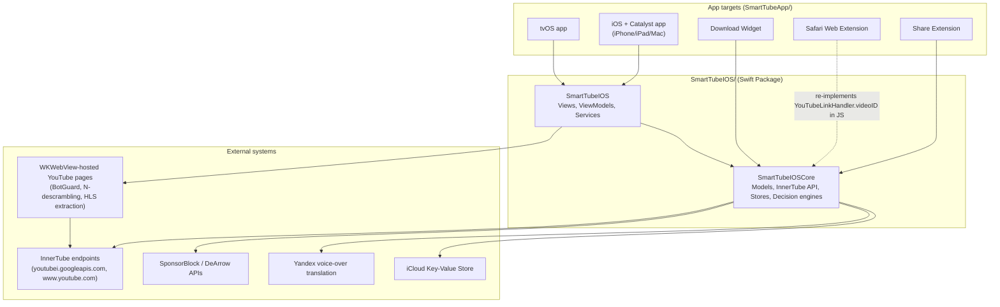

# Architecture overview

> How to update this doc: use `scripts/metrics.sh` for measured source metrics;
> update the target list whenever WS8 changes `Package.swift` targets. This doc describes
> the system as it is. Planned work and verification gaps are in [open questions](OPEN_QUESTIONS.md).
> Reviewed against source on 2026-10-15; runtime acceptance was not repeated.

## Containers

Dependency direction: `SmartTubeIOSCore` must never import `SmartTubeIOS`, SwiftUI, UIKit, AVFoundation, or WebKit (intended rule; existing violations are tracked in [OQ-0009](OPEN_QUESTIONS.md#oq-0009--architecture-debt)). App targets depend on the package; the package never depends on an app target.

## Modules

| Module / area | Directory | Owner workstream | Notes |
|---|---|---|---|
| `SmartTubeIOSCore` | `SmartTubeIOS/Sources/SmartTubeIOSCore/` | WS6 (core hardening), WS3 (tests) | Should be Foundation-only; currently imports SwiftUI/AVFoundation/JavaScriptCore/ActivityKit/Network too |
| `SmartTubeIOS` (views/view models/services) | `SmartTubeIOS/Sources/SmartTubeIOS/` | WS7 (UI/composition), WS4/WS5 (player) | |
| Playback (`PlaybackViewModel` + AVPlayer path) | `SmartTubeIOS/Sources/SmartTubeIOS/ViewModels/PlaybackViewModel*.swift` | WS4 (seams/pipeline), WS5 (session) | The critical path — see below |
| Shorts player | `SmartTubeIOS/Sources/SmartTubeIOS/Views/Player/ShortsPlayerView*.swift` | WS5 | Vertical-swipe UI over `PlaybackViewModel` on all platforms |
| Stream resolution (JS extractors, descramblers) | `SmartTubeIOS/Sources/SmartTubeIOS/Services/YouTube*.swift`, `BotGuardWebViewRunner.swift` | WS4 | New `StreamResolver` target planned (WS8) |
| App targets, composition roots | `SmartTubeApp/Sources/`, `SmartTubeApp/Smart Tube/` | WS7, WS1 | |
| Tests | `SmartTubeIOS/Tests/`, `SmartTubeApp/UITests/` | WS3 | |
| Tooling / CI | repo root, `.github/`, `scripts/` | WS1 | |
| Docs / plans | `docs/**` | WS2 | [Plan lifecycle](exec-plans/README.md) |

The private ownership/modernization records have not been imported or checked; see [OQ-0001](OPEN_QUESTIONS.md#oq-0001--public-documentation-migration).

## Playback

The current AVPlayer path still uses an ordered cascade. [ADR-0005](adr/0005-stream-source-pipeline.md) proposes an adapter pipeline; it is not implemented:

1. A tap reaches `PlayerRouter.open` (`PlayerRouter.swift`).
2. `PlayerRouter` presents the AVPlayer pipeline (the embed players were removed — [ADR-0010](adr/0010-remove-iframe-player.md)):
   `PlayerStateStore` → `PlayerView.onAppear` → `PlaybackViewModel.load` → `loadAsync` → a VISIONOS-client HLS attempt (then the iOS-client one if VISIONOS returns no HLS) → `exhaustiveRetry` if that fails. Once audio tracks are known, `applyAudioLanguagePolicy` (`PlaybackViewModel+VoiceOver.swift`) may start a Yandex voice-over translation.
3. `exhaustiveRetry` now lives in `PlaybackViewModel+ExhaustiveRetry.swift`; concurrent paths live in `+FallbackRace.swift`, with stream loading, attempts, and observer helpers in separate extensions. Splitting files has not replaced the ordered cascade with `ResolutionPipeline`.
4. Successful paths perform `.readyToPlay` bookkeeping: duration refresh, seek restore, audio-track loading, loading-state reset, and timing. Parity and ownership work remain tracked in [OQ-0002](OPEN_QUESTIONS.md#oq-0002--stream-pipeline-and-contributor-guide).

Shorts use `ShortsPlayerView` over `PlaybackViewModel` on every platform. The proposed `PlaybackSession` remains [open](OPEN_QUESTIONS.md#oq-0009--architecture-debt).

On iOS, `PlayerStateStore` owns the regular player's persistent `AVPlayerLayer`,
PiP controller and delegate. Fullscreen and mini-player containers attach that
same layer only when their presentation is active. PiP entry dismisses fullscreen;
the UIKit presenter confirms restoration after presentation and layout finish.
Shorts own a separate playback view model and stop the regular player on entry.

Current source inspection is distinct from [device acceptance](OPEN_QUESTIONS.md#oq-0005--playback-device-acceptance).

## Deep links

Four entry adapters converge on one point:

- Share Extension → `YouTubeLinkHandler.videoID`
- Siri Shortcuts
- Safari Web Extension (re-implements `YouTubeLinkHandler.videoID` in JavaScript, kept in sync by hand with a policing test — a duplication WS6 should resolve)
- Custom URL scheme

Entry adapters use browse state and app/view observers to open their destinations. `PlayerRouter` selects the iOS player; a shared app-wide navigation router remains proposed. Navigation and composition consolidation are tracked in [OQ-0009](OPEN_QUESTIONS.md#oq-0009--architecture-debt).
