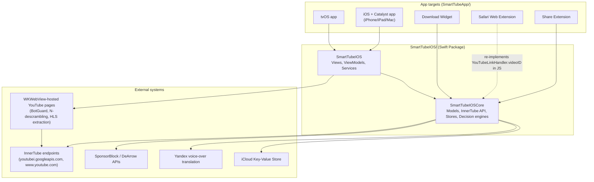

# Architecture overview

> How to update this doc: use `scripts/metrics.sh` for measured source metrics;
> update the target list whenever WS8 changes `Package.swift` targets. This doc describes
> the system as it is. Planned work and verification gaps are in [open questions](OPEN_QUESTIONS.md).
> Source boundaries and ownership updated on 2026-10-17; physical-device acceptance remains separate.

## Containers

Dependency direction: `SmartTubeIOSCore` must never import `SmartTubeIOS`, SwiftUI, UIKit, AVFoundation, or WebKit. The [Core import check](../scripts/check-core-imports.py) enforces permitted imports, including a file-scoped list of remaining legacy adapters tracked in [OQ-0009](OPEN_QUESTIONS.md#oq-0009--architecture-debt). App targets depend on the package; the package never depends on an app target.

## Modules

| Module / area | Directory | Owner workstream | Notes |
|---|---|---|---|
| `SmartTubeIOSCore` | `SmartTubeIOS/Sources/SmartTubeIOSCore/` | WS6 (core hardening), WS3 (tests) | Foundation-only remains the target; explicit legacy imports: Network, JavaScriptCore, ActivityKit, ImageIO and UniformTypeIdentifiers |
| `SmartTubeIOS` (views/view models/services) | `SmartTubeIOS/Sources/SmartTubeIOS/` | WS7 (UI/composition), WS4/WS5 (player) | |
| Playback (`PlaybackViewModel` + AVPlayer path) | `SmartTubeIOS/Sources/SmartTubeIOS/ViewModels/PlaybackViewModel*.swift` | WS4 (seams/pipeline), WS5 (session) | The critical path — see below |
| Shorts player | `SmartTubeIOS/Sources/SmartTubeIOS/Views/Player/ShortsPlayerView*.swift` | WS5 | Vertical-swipe UI over `PlaybackViewModel` on all platforms |
| Stream resolution (JS extractors, descramblers) | `SmartTubeIOS/Sources/SmartTubeIOS/Services/YouTube*.swift`, `BotGuardWebViewRunner.swift` | WS4 | New `StreamResolver` target planned (WS8) |
| App targets, composition roots | `SmartTubeApp/Sources/`, `SmartTubeApp/Smart Tube/` | WS7, WS1 | |
| Tests | `SmartTubeIOS/Tests/`, `SmartTubeApp/UITests/` | WS3 | |
| Tooling / CI | repo root, `.github/`, `scripts/` | WS1 | |
| Docs / plans | `docs/**` | WS2 | [Plan lifecycle](exec-plans/README.md) |

The private ownership/modernization records have not been imported or checked; see [OQ-0001](OPEN_QUESTIONS.md#oq-0001--public-documentation-migration).

## Home feed and settings

App entry points own one `HomeViewModel`, inject it into the visible Home and attach
`HomeWidgetPublisher` to its completed result. The app's separate `BrowseViewModel`
still serves navigation and other sections, but does not fetch a hidden Home feed.
Session changes invalidate pending Home results and clear the widget; access-token
rotation preserves the existing feed. Widget image work runs outside the main actor;
the final snapshot write and sign-out clear are serialized together.

Home's section model receives the saved History setting before authentication or
section loading. Core retains settings data and SponsorBlock decisions; the theme's
SwiftUI mapping and SponsorBlock's native seek adapter live in `SmartTubeIOS`.

## Playback

The current AVPlayer path still uses an ordered cascade. [ADR-0005](adr/0005-stream-source-pipeline.md) proposes an adapter pipeline; it is not implemented:

1. A tap reaches `PlayerRouter.open` (`PlayerRouter.swift`).
2. `PlayerRouter` presents the AVPlayer pipeline (the embed players were removed — [ADR-0010](adr/0010-remove-iframe-player.md)):
   `PlayerStateStore` → `PlayerView.onAppear` → `PlaybackViewModel.load` → `loadAsync` → a VISIONOS-client HLS attempt (then the iOS-client one if VISIONOS returns no HLS) → `exhaustiveRetry` if that fails. Once audio tracks are known, `applyAudioLanguagePolicy` (`PlaybackViewModel+VoiceOver.swift`) may start a Yandex voice-over translation.
3. `exhaustiveRetry` now lives in `PlaybackViewModel+ExhaustiveRetry.swift`; concurrent paths live in `+FallbackRace.swift`, with stream loading, attempts, and observer helpers in separate extensions. Splitting files has not replaced the ordered cascade with `ResolutionPipeline`.
4. Successful paths perform `.readyToPlay` bookkeeping: duration refresh, seek restore, audio-track loading, loading-state reset, and timing. Parity and ownership work remain tracked in [OQ-0002](OPEN_QUESTIONS.md#oq-0002--stream-pipeline-and-contributor-guide).

`InitialPlayerInfoSource` owns initial metadata acquisition: cached info, an existing shared fetch, then VISIONOS and the existing legacy operation. It returns the source origin so the view model retains the correct HLS hint. It does not own an AVPlayer or replace the remaining fallback cascade.

`PlaybackDemandCoordinator` is the single Foundation-only policy owner for optional transfer priority. The AVPlayer adapter publishes preparation, actual playback, later buffering and deliberate pause. Cache prefetch, native Shorts preparation and offline transfers subscribe to the same signal. Owner tokens, stable recovery and a bounded later-buffer wait prevent stale events and repeated pauses from monopolizing the connection.

Offline state belongs to `OfflineLibraryStore`: an actor writes an atomic local manifest with stable job IDs and distinct retry attempts. `OfflineCoordinator` projects that state into the UI and serializes admission. `OfflineDownloadTransport` uses system background URLSession downloads and iOS AVAssetDownloadURLSession for complete HLS packages; durable completion receipts connect system delivery to the manifest. HLS packages stay at Apple's provided location. VOT preparation polls are deferred in the durable queue so another video can proceed while translation is being prepared. Downloaded original audio and VOT audio are separate assets; local playback never enters the online stream fallback.

Shorts use `ShortsPlayerView` over `PlaybackViewModel` on every platform. The proposed `PlaybackSession` remains [open](OPEN_QUESTIONS.md#oq-0009--architecture-debt).

On iOS, `PlayerStateStore` owns the regular player's persistent `AVPlayerLayer`,
PiP controller and delegate. Fullscreen and mini-player containers attach that
same layer only when their presentation is active. PiP entry dismisses fullscreen;
the UIKit presenter confirms restoration after presentation and layout finish.
Shorts own a separate playback view model and stop the regular player on entry.
That model owns one native next-video preloader; the prepared player is adopted intact on swipe
and managers/observers follow it. Backgrounding, dismissal and memory pressure cancel preparation.
The view's Core feed window bounds recent navigation and cursors; see [ADR-0011](adr/0011-bounded-native-shorts-preloading.md).
Their audio/translation picker is shared with the regular player. `AppSettings`
stores independent Shorts language, automatic translation, lively voice and original
audio choices, seeded from legacy settings once on upgrade. The Shorts playback model
resolves those preferences on initialization and every settings update; the shared
picker writes only the active player's preferences. Both reuse the same Yandex service
and Keychain token, and read the same persisted Fit/Fill setting.
Account Shorts come from authenticated subscription
pages plus Shorts present in Home recommendations; signed-out discovery uses search.
Home and Recommended reuse their subscription response instead of loading it twice.
The Shorts player retains source-tagged continuation tokens and discards them when
the account changes. Empty/duplicate page scanning is bounded per request; the
Shorts section preserves its continuation for the user to request more. This is
not a replica of YouTube's mobile reel ranking.
Presentation reads video identity from the playback model, with no separate current-video
copy. A stopped, parked item is excluded from presentation until explicitly reopened.

`PlaybackAudioSession` serializes native audio-session transitions outside `MainActor`.
Each playback intent can be revoked synchronously before delayed activation or stop
work finishes. UI resume paths own one cancellable task; ready callbacks can publish
metadata while that task waits to start the current item. Configuration is deferred
until playback, and transition outcomes/durations are recorded in the local log.
Stopped player items and idle WebViews retain a 60-second reuse window; memory
pressure can release them earlier without interrupting active playback or requests.

Current source inspection is distinct from [device acceptance](OPEN_QUESTIONS.md#oq-0005--playback-device-acceptance).

## Deep links

Four entry adapters converge on one point:

- Share Extension → `YouTubeLinkHandler.videoID`
- Siri Shortcuts
- Safari Web Extension (re-implements `YouTubeLinkHandler.videoID` in JavaScript, kept in sync by hand with a policing test — a duplication WS6 should resolve)
- Custom URL scheme

Entry adapters use browse state and app/view observers to open their destinations. `PlayerRouter` selects the iOS player; a shared app-wide navigation router remains proposed. Navigation and composition consolidation are tracked in [OQ-0009](OPEN_QUESTIONS.md#oq-0009--architecture-debt).
